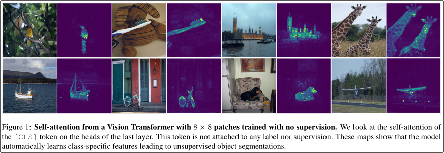
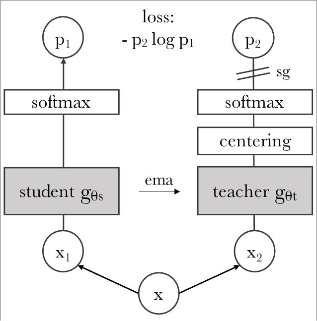
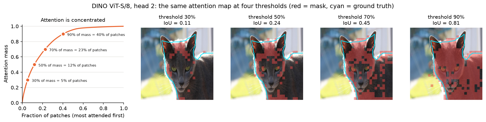
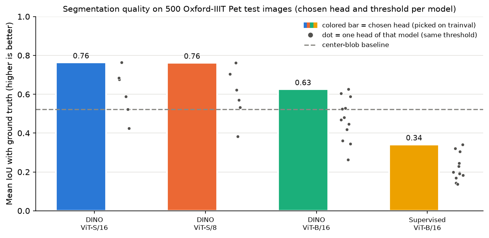
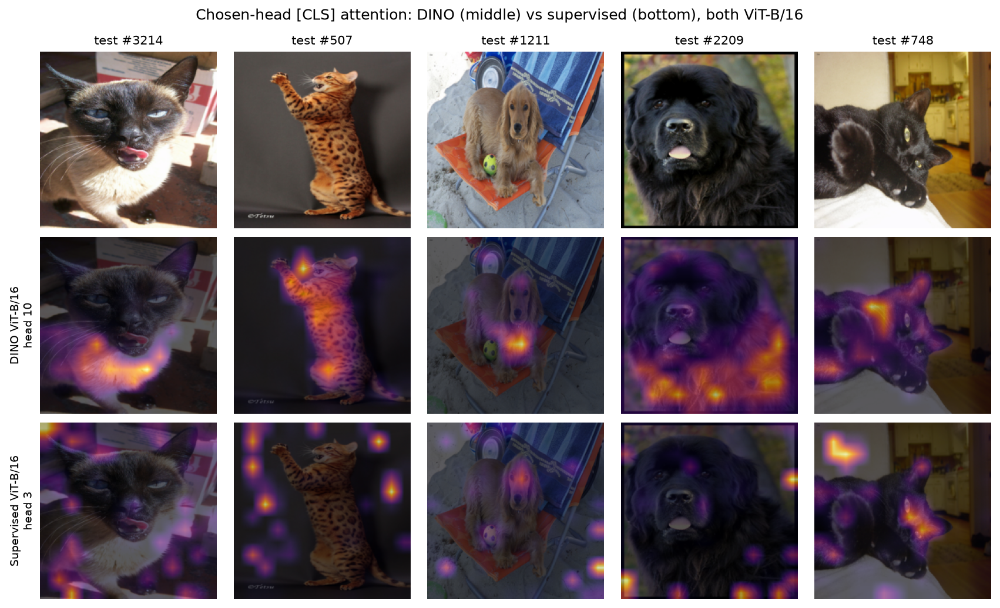
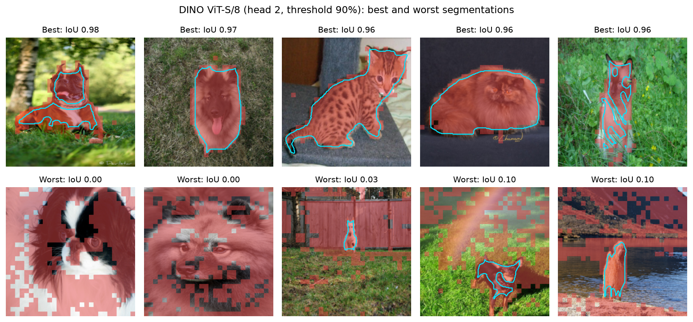
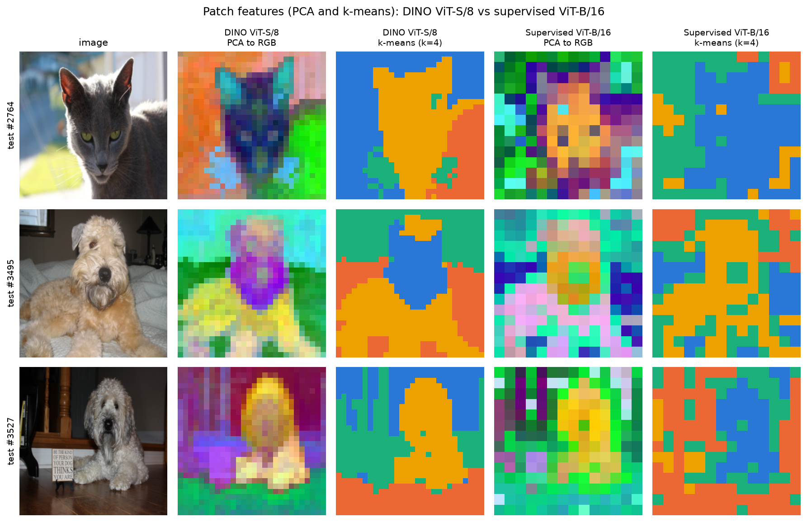

# DINO for Image Segmentation

Author: Porter Rigby

In the world of computer vision, one of the most central and important tasks is identifying important objects within an image. While there are multiple ways to approach said task, the use of segmentation masking is particularly useful (particularly over bounding boxes) as it gives more precise predictions. How do you acquire such a mask though? One way is through the use of DINO on vision transformers (ViTs).

## What is DINO?

DINO (self-**di**stillation with **no** labels) is a training approach for vision models without the use of labels, proposed by researchers at Meta AI (formerly Facebook AI), Inria, and Sorbonne University. The authors argued that supervised training as had been done with ViTs previously, threw out valuable information that could be used for learning. Specifically, that the self-supervised approaches for training transformer models such as BERT could also be applied to vision models. While the approach itself can be used with both CNNs and ViTs, DINO produces emergent behaviors when used to train ViTs that can be leveraged specifically for the purpose of segmentation masking. 

The idea is to perform knowledge distillation using the ViT as a student model, and a moving average of previous student model iterations as the teacher (hence the self-distillation). Different augmented crops of the same image are fed to both the student and teacher models, with the goal of aligning their outputs. 

The resulting model outputs a **[CLS]** token that summarizes each image, and **patch** tokens that hold spatially accurate and semantically meaningful information. Further, the final layer of each attention head within the ViT can be used to acquire an attention map (what patches are relevant/important) with respect to the [CLS] token. This attention map focuses on the most characteristic parts of the image being inferred upon.

## How do we segment images with DINO?

**Models.** We examine three DINO models (ViT-S/16, ViT-S/8 and ViT-B/16) and a supervised ViT-B/16 trained on ImageNet labels. The supervised model and DINO ViT-B/16 have the *exact same architecture*, so any difference between them comes from how they were trained.

**Data.** We will use the **Oxford-IIIT Pet** dataset, comprised of photos of 37 different cat and dog breeds. Each sample contains a ground-truth mask highlighting which pixels of the image belong to a pet, and which do not. We tune mask thresholds using 300 images from the **trainval** split, and then test performance on 500 images from the **test** split. While it is perfectly feasible to finetune a DINO model for better performance, for simplicity we only examine pretrained models here. All images are scaled down to 224x224.

**From attention to a mask.** In order to acquire the segmentation masks, we take the attention (w.r.t. [CLS] token) for every patch from the final layer of an attention head. Doing this gives us an attention map for the entire image, from which we can choose a mass threshold for how much of the map to keep. Patches that are above the threshold get used for the segmentation map.

Attention is very concentrated. In this example, half of the attention mass sits in just 12% of the patches. Keeping 30% of the mass covers only the cat's ears and forehead (IoU 0.11), while keeping 90% covers most of the cat (IoU 0.81).

**Choosing a head and a threshold.** That leaves two choices for each model: which head to use and how much mass to keep. The authors of the original DINO paper showcased this use of attention maps for masking using a 60% threshold and taking the best possible head for each image. For our purposes though, our dataset is noticeably different and we would like to see how well this approach generalizes for prediction rather than just evaluating using a best-case scenario. To do this, we use the 300 images from the trainval split to choose an attention head and threshold value. These choices are then evaluated on the 500 test split images.

**Scoring.** We use Intersection over Union (IoU) to evaluate the difference between the predicted and ground-truth masks. 1 represents a perfect match while 0 indicates no overlapping pixels. We also take a "center-blob" prediction as a baseline, where a fixed ellipse is predicted in the middle of every image. We do this because pets in this dataset are usually photographed in the center, and we would like to beat such a naive assumption.

## Observations

**DINO segments pets well, and much better than the supervised model.** After tuning on trainval, we end up choosing a 90% threshold for every model. Below are the evaluation results both at 90% mass and 60%.

| Model | Chosen head | Test IoU | Same head at paper's 60% | Beats baseline on |
|---|---|---|---|---|
| DINO ViT-S/16 | 1 of 6 | **0.76** | 0.50 | 95% of images |
| DINO ViT-S/8 | 2 of 6 | **0.76** | 0.39 | 93% |
| DINO ViT-B/16 | 10 of 12 | 0.63 | 0.32 | 71% |
| Supervised ViT-B/16 | 3 of 12 | 0.34 | 0.16 | 19% |
| Center-blob baseline | n/a | 0.52 | n/a | n/a |

There are a couple of things to notice:

* **Same network, very different results.** DINO ViT-B/16 beats the supervised ViT-B/16 on 92% of test images (0.63 vs 0.34 IoU). This follows the results from the original paper, so we can see that even just using the pretrained models as backbones for a different dataset the results are still the same.
* **The threshold matters significantly.** At a 60% threshold, every DINO model falls *below* our naive baseline. This is likely because pets in this dataset take up a significant portion of the entire image, and 60% of the mass only gives masks with a few patches.

**Where does the attention go?** The table below shows the share of each model's attention that lands on the pet. If attention were spread evenly, the pet would get 32%, which is the share of the image it covers.

| Model | Attention on the pet | Pet's share of the image |
|---|---|---|
| DINO ViT-S/16 | 70% | 32% |
| DINO ViT-S/8 | 76% | 32% |
| DINO ViT-B/16 | 72% | 32% |
| Supervised ViT-B/16 | 36% | 32% |

DINO puts more than twice its "fair share" of attention on the pet, while the supervised model barely attends to the pet at all. We can see that the attention is scattered and noisy, which is exactly what we would expect based on the results the DINO authors produced. This is a byproduct of the supervised training process allowing classifiers to rely on context clues more than the actual objects in the image, thereby never fully learning where the attention should sit spatially.

**Where it fails.** The worst DINO masks come from tiny, distant pets in busy scenes, where keeping 90% of the mass spills onto the background, and from close-ups where the pet fills the whole frame (some of these may be annotation quirks). Small pets are still much harder for the baseline than for DINO:

| Mean test IoU | Small pets | Large pets |
|---|---|---|
| DINO ViT-S/8 | 0.73 | 0.80 |
| Supervised ViT-B/16 | 0.31 | 0.38 |
| Center-blob baseline | 0.39 | 0.65 |

This is where we start to see a problem with our approach: by choosing a static threshold and not finetuning, each model fails to generalize beyond the cases where the pet is a significant part of the image.

**Going one step further: grouping patches.** The paper's segmentations come from attention heads, but DINO's patch embeddings can also be used directly. We can assign an RGB value to each patch by its top three PCA components and grouped the patches with k-means (k = 4). Patches the model sees as similar get similar colors, because DINO as an approach learns to cast patches into a latent representation space that clusters concepts together surprisingly well.

We can see that the supervised model does manage to keep some outlines and general shapes, but these are noisy and wouldn't be very useful for segmenting. DINO on the other hand coherently splits the image into segments such as the animal's face, body, or whiskers.

## Conclusion

In this demo, we show the use of DINO (v1) for simple image segmentation, both using the attention from the underlying ViT [CLS] token, and the output patch embeddings themselves. We show that even without finetuning the model, DINO gives positive results with selective masking thresholds over a naive baseline. DINO's representation space generalizes better than that of supervised ViTs on the same segmentation tasks, and can provide coherent masks through the use of PCA and KMeans clustering. That being said, there are still significant limitations with this approach. The attention maps only show areas of importance in each image, but do not actually give us an idea of what the individual objects are. We are also choosing a best-performing static threshold based on training data from the same dataset. Regardless, being able to identify what parts of an image are important and how the image breaks apart semantically opens the door for many interesting applications.

**References:** M. Caron et al., *Emerging Properties in Self-Supervised Vision Transformers*, ICCV 2021 (code: <https://github.com/facebookresearch/dino>). A. Dosovitskiy et al., *An Image is Worth 16x16 Words*, ICLR 2021. O. M. Parkhi et al., *Cats and Dogs* (Oxford-IIIT Pet), CVPR 2012. M. Oquab et al., *DINOv2*, 2023.
